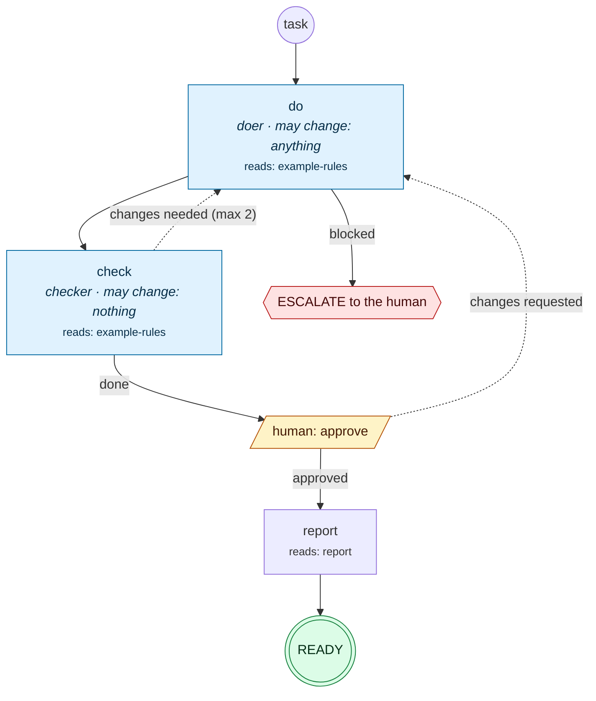

# psai

A tool-agnostic agent harness for Claude Code, opencode, pi and oh-my-pi (omp). It ships **vanilla**: a workflow engine, a guide that builds your own workflows with you, knowledge capture, and empty, documented folders. You fork it and build your own stack in the fork. Every skill is model-invoked, so agents run your workflows on their own.

## Use it
1. Fork this repo on GitHub, then clone **your fork** anywhere:
   ```sh
   git clone <your-fork-url> psai && cd psai
   ```
2. Install. It works from wherever the clone is; preview first:
   ```sh
   ./install.sh --dry-run
   ./install.sh
   ```
3. Ask any agent to set up your harness. The `customize-harness` skill interviews you one question at a time, then builds your first workflow with its steps, roles, guides and templates. Each piece is filed per [LAYOUT.md](LAYOUT.md), validated, and committed on a `customize/` branch for you to merge.

From then on, give agents tasks as usual. `work` routes each task to one of your workflows and runs it.

## Get upstream updates
```sh
git remote add upstream <psai-upstream-url>   # once
git pull upstream main
./install.sh
```
psai never ships files in the places you own (your workflows, steps, roles, guides, templates, knowledge and `instructions/owner.md`). Upstream changes therefore merge without conflicts. `scripts/check.sh` tests exactly that.

## How it works
- **The nudge:** each tool gets a plugin that injects a short, live always-on text (about 110 words plus a line per workflow): the core rules, your `owner.md`, "run the request-router skill first", and your workflows' names and `when`.
- **`request-router`:** decides each request. A matching workflow runs; a repeatable task with no workflow escalates and offers `customize-harness`; a one-off is handled normally.
- **`work`:** the engine, read once a workflow is chosen. It runs the workflow node by node:
  - a fresh agent per role;
  - each role's git diff checked against its `may_change`;
  - loop limits;
  - escalations in one fixed format;
  - a final report.

  `trace.sh` refuses any move that isn't an edge of the workflow.
- **`customize-harness`:** bootstraps your first workflow, and later adds or changes one piece. It offers proven design patterns as options, never as defaults.
- **`capture-knowledge`:** agents record facts, decisions and proposed rules in inboxes. Promotion happens by PR, which you merge.

## Layers
| Layer | Answers | Written by | Loaded |
|---|---|---|---|
| skill | how the machinery runs | upstream | discovered by the tool |
| role | who I am and what I may touch | you | when the role starts |
| step | what happens at this point | you | when the step runs |
| guide | how this kind of work must be done | you | when a role or step attaches it (`read:`) |
| template | the exact output format, with an example | you | when a step attaches it |
| knowledge | what's true, and what was decided and why | agents, via the inbox | on demand, via `knowledge/INDEX.md` |

During a task, agents write only to knowledge inboxes and to the task's PR description or report. Everything else changes through `customize-harness`, as a PR you approve. Precedence, most specific wins: `<repo>/.psai/` > the step or role and its `read:` files > `instructions/owner.md` > `instructions/global.md`.

## Structure
```
instructions/global.md   core rules in the injected nudge (≤120 words); your rules go in instructions/owner.md
plugins/                 one per tool (claude, pi, omp, opencode); each injects `scripts/harness.py context` live
skills/                  request-router, work (engine, escalation format, check-diff.sh, trace.sh), customize-harness (+ patterns/), capture-knowledge
workflows/ steps/ roles/ guides/ templates/ knowledge/   yours; empty in vanilla (README only)
scripts/                 check.sh, simulate.py, graph.py, harness.py
evals/                   run.sh, driver.py, fixtures/, scenarios/, graders/, results/
docs/decisions/          ADRs about psai itself
LAYOUT.md                where every kind of file goes, and who owns it
```

## Example workflow (test content)
Vanilla has no workflows. This is the tiny, neutral `example` workflow from `evals/fixtures/harness-content/`, which the tests use. Dotted edges are loops; each automatic loop shows its limit. Your own workflows' diagrams go in `workflows/GRAPHS.md`.

<!-- graph:evals/fixtures/harness-content/workflows/example.yaml:start -->

<!-- graph:evals/fixtures/harness-content/workflows/example.yaml:end -->

## Install details
It installs only for tools whose config folder exists (`~/.claude`, `~/.config/opencode`, `~/.pi/agent`, `~/.omp/agent`):
- links `~/.psai` to your clone (set `PSAI_HOME` to use another path; set it for your tools too, since the skills and plugins read it);
- links each skill into `~/.claude/skills` and `~/.agents/skills`, never replacing one that isn't its own, and removes its own stale links;
- installs ONE plugin per tool, which injects the nudge read live from `~/.psai`:
  - **Claude Code:** adds this repo as a marketplace (`.claude-plugin/marketplace.json`) and installs `psai@psai` (a SessionStart hook);
  - **pi:** links the extension `~/.pi/agent/extensions/psai.ts`;
  - **omp:** links the extension `~/.omp/agent/extensions/psai.ts`;
  - **opencode:** writes a stub `~/.config/opencode/plugin/psai.js` that imports the live plugin;
- removes v1's import lines and marked blocks from `CLAUDE.md` and `AGENTS.md` files, keeping everything else.
- removes the legacy base link `~/.harness` (its name before the rename to `~/.psai`) if it is a link to a psai clone, and relinks what went through it; anything else at that path is left alone.

It backs up `~/.claude/settings.json` before the plugin CLI first changes it. opencode reads both skill folders, so it loads each skill once and logs a `duplicate skill name` warning; `OPENCODE_DISABLE_CLAUDE_CODE_SKILLS=1` silences it. **Uninstall:** `./install.sh --uninstall` (backups are kept).

## Tests
```sh
scripts/check.sh              # L0 structure, L1 installer and fork updates, L2 simulator
scripts/check.sh --discover   # plus: opencode, pi and omp list the skills from a temp HOME
evals/run.sh                  # L3 + L4 AI evals, headless, on throwaway copies (costs money; keep it small)
```
- **L0:** LAYOUT placement, every README, frontmatter, every `step`/`read:`/`role` path, and the graph rules: reachable, ends at ready, escalate or a handoff, and every automatic loop has a limit. Also checks that diagrams are fresh, that `check-diff.sh` enforces `may_change`, and that `trace.sh` enforces the graph.
- **L1:** install, update, uninstall, dry-run, idempotency, no clobbering, stale-link and v1 cleanup for all four tools. `scripts/test-plugins.sh` proves, with no AI and no network, that each plugin's nudge reaches the session. Also checks that a fork with user content pulls an upstream change to every upstream-owned file without conflicts.
- **L2:** `simulate.py` walks each workflow with scripted outcomes (`workflows/<name>.cases.yaml`).
- **L3/L4:** see [evals/README.md](evals/README.md).
