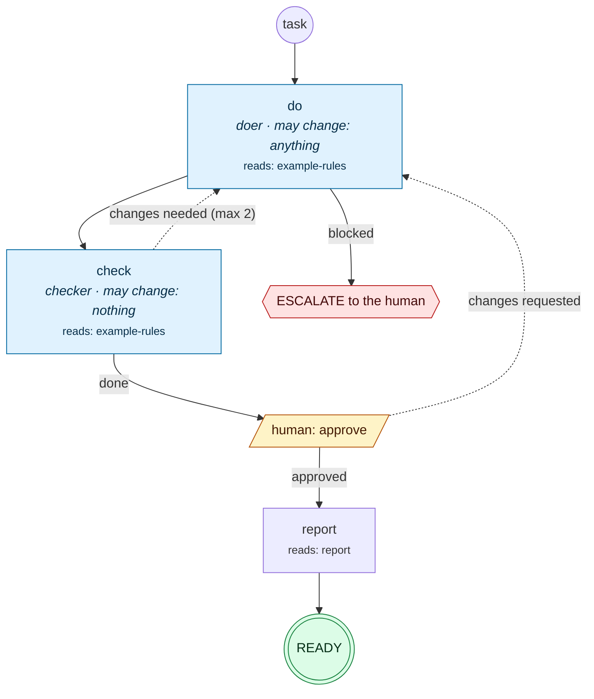

# psai

A tool-agnostic agent framework for Claude Code, opencode, pi and oh-my-pi (omp). psai is the **framework**: a router, a workflow engine, role agents with checked boundaries, knowledge capture, retros and sync. It ships no workflows. Your workflows, roles, steps, guides, templates and skills live in **stacks**: git repos you install, several at once, or author and publish yourself. Your own adjustments live in your **overlay**, the stack `nostack`, which always wins. Every skill is model-invoked, so agents run your workflows on their own. Design: [docs/decisions/0011-framework-and-stacks.md](docs/decisions/0011-framework-and-stacks.md).

## Install the framework
```sh
git clone https://github.com/noueii/psai && cd psai
./install.sh --dry-run    # preview
./install.sh
```
This sets up `~/.psai` (`$PSAI_HOME` moves it): `framework/` links this clone, `overlay/` is your own stack (a git repo; push it to a remote of yours to move your setup), `stacks/` the stacks you install and `state/` this machine's state. It installs one plugin per tool and the `psai` command (`~/.local/bin/psai`). Already on a fork of psai 2.x? Install from your fork: migration 0002 moves your workflows, roles, knowledge and skills into your overlay, and leaves the clone's files alone.

Then ask any agent to set up a workflow: the `customize-harness` skill interviews you one question at a time and builds it in your overlay (or a stack). At the end of the task the `retro` skill turns what was staged into a PR on your overlay for you to merge. From then on, give agents tasks as usual: `request-router` picks the workflow, `work` runs it, then a retro.

`psai --help` lists every command: `status`, `doctor`, `stack`, `new-stack`, `check`, `eval`, `sync`, `retro`, `update`, `adopt`, `resolve`, `route`, `node`, `setup models`, ...

## Standalone packages
`psai build --standalone [<stack>] [--target ...]` packages one stack with a pinned copy of the framework for people who don't install psai, one native package per tool in `dist/<stack>/`:
- `claude/`: a Claude Code plugin (hooks inject the nudge; the framework's and the stack's skills), with a `marketplace.json` next to it (`claude plugin marketplace add <dist/stack>`);
- `agent-plugins/`: the open plugin format Cursor reads (`.cursor-plugin/plugin.json`, skills, the nudge as an always-applied rule), with its `marketplace.json`;
- `pi/`: a pi package (`pi install <dir>`); `omp/`: an omp plugin (`omp plugin install <dir>`);
- `opencode/`: an `install.sh` that adds a stub plugin and links the skills.

Each bundle is a psai home of its own: stack management is disabled there and the retro's suggestions go to the stack's author. It needs python3 and PyYAML. With `build: {commit_dist: true}` in stack.yaml, commit `dist/` (drop it from `.gitignore`); the template's CI then fails when it's stale (`psai build --standalone --check`).

## Add stacks
A stack is a git repo of workflows, roles, steps, guides, templates and skills with a `stack.yaml` (ADR 0011). Install as many as you like; every name is namespaced (`stack:workflow`), and your overlay `nostack` always wins:
```sh
psai stack add github:owner/repo          # the newest release tag that takes your psai; shows what it injects, then asks
psai stack add <git URL or path> --ref v1.2.0 [--as other-name]
psai stack add ~/src/my-stack --dev       # link your working clone instead of a pinned copy
psai stack list | update [<name>] | remove <name> | diff <name> [<path>]
psai stack sync                           # a new machine: install everything your overlay's stacks.yaml lists
```
Skills from several stacks share the tools' flat skill folders. psai's own names are reserved; for any other name, the tools see your overlay's copy, else the higher-priority stack's (`psai stack list --skills` shows which). A role always gets its own stack's copy, because its brief gives the SKILL.md path. Stack authors: prefix your skill names (`acme-changelog`); `psai stack check` warns otherwise.

A role may name its model: `model: strong` (a tier: `fast | balanced | strong`) or ids per tool (`model: {claude: opus, pi: claude-opus-5-5}`); a stack sets defaults in `stack.yaml` (`models: {default: balanced, roles: {reviewer: strong}}`), and your overlay's `models.roles["acme:reviewer"]` wins. `psai setup models` writes your tier map per tool. `work` passes the model when it delegates: Claude Code's Agent `model` and pi's `--model`; opencode's and omp's task tools can't set one per call, so it says so in the final report.

To change one file of a stack, override it in your overlay instead of forking the stack: `psai stack override acme:roles/reviewer.md` copies it to `~/.psai/overlay/overrides/acme/roles/reviewer.md` for you to edit; `psai stack update` tells you when the original changes, and `psai stack check acme` validates the stack with your overrides in place. Adding a stack never runs its code. A release is a `vX.Y.Z` tag; a branch is never pinned. A stack's `requires:` are installed with it, one version each; a conflict is refused.

## Make a stack
`psai new-stack acme` creates `./acme` from [template/stack/](template/stack/stack.yaml): a git repo with a `stack.yaml`, a README per content folder and a CI workflow, added to this machine as a dev stack (psai reads your working clone). Build its workflows with the `customize-harness` skill, which asks first which stack a change goes to. `psai check acme` (or `psai check .` in its folder) validates it; `psai eval acme` runs its eval scenarios in a temp home. `psai publish` releases it: it checks the stack, refuses a dirty tree or an existing tag, tags `v<version>` and pushes the tag (asking first); `--standalone` also attaches the standalone packages to a GitHub release.

## Get updates: the sync skill
End your workflows with a `sync` node (`handover → retro → sync → ready`; customize-harness offers it) or ask any agent to sync. Sync checks first, deterministically and with short-timeout fetches: a newer psai release, a newer release of a pinned stack in range, new commits on your overlay's remote, an install that doesn't match the framework, pending migrations, sessions or staged changes not yet in a PR, tool drift. Nothing out of sync: it stops at zero cost. Otherwise it fast-forwards your overlay (keeping your local inbox entries) and the framework, re-installs, runs pending migrations, moves stack pins you agree to (`psai stack update`, which reports overrides whose original changed), adopts drift worth keeping by staging it, and opens one PR per repo you own (your overlay, each stack you author). A framework release that one of your stacks doesn't support yet is refused unless you force it (the stack is then disabled until it updates); a conflict changes nothing and reports "psai update waiting: needs you".

**Trade-off:** psai has no background job, no cron and no startup check. It updates only when a workflow runs sync, or when you ask an agent to sync (`psai sync` runs the deterministic part by hand).

## How it works
- **The nudge:** each tool gets a plugin that injects a short, live always-on text (about 180 words plus a line per workflow, ≤ 300 words of workflow lines: low-priority stacks collapse to one line): the core rules, your `owner.md`, each stack's short rules, "run the request-router skill first", every installed workflow as `stack:name` with its `when`, "to add or change a skill, use customize-harness", when to run the retro outside a workflow, how many skills in your tool folders psai doesn't manage, and how many earlier sessions still wait for a retro (only when some do).
- **`request-router`:** decides each request from the merged index of every installed stack (`psai route`). A matching workflow runs (several: your `prefer` rules, then priority); a repeatable task with no workflow escalates and offers `customize-harness`; a one-off is handled normally.
- **`work`:** the engine, read once a workflow is chosen. It runs the workflow node by node:
  - a fresh agent per role;
  - each role's git diff checked against its `may_change`;
  - loop limits;
  - escalations in one fixed format;
  - a final report.

  `psai trace` refuses any move that isn't an edge of the workflow; `psai node` gives the engine each node's files, resolved by name, and the role's skills and model.
- **`customize-harness`:** asks which stack a change goes to (your overlay, a stack you author, or a new one), then bootstraps a first workflow or adds or changes one piece. It offers proven design patterns as options, never as defaults. Someone else's stack changes only through an override in your overlay.
- **`capture-knowledge`:** agents record facts, decisions and proposed rules in inboxes, which always live in your overlay. Nothing goes to GitHub while a task runs.
- **`retro`:** at the end of a task (`work` always runs it after a workflow; outside workflows the agent runs it when it captured or staged something; a session that ended without one is flagged in the next session's nudge). It reads the run (trace, inbox entries, escalations, loops at their limit, rejected diffs, review findings, time and tokens), ranks findings and files each where it belongs: your preferences in your overlay, a stack you author in that stack, someone else's stack as an override in your overlay plus a drafted suggestion for its author (a PR to them only when you say yes). It opens one PR per repo it changed, the report as the description. Nothing worth changing: no PR.
- **`sync`:** runs only where a workflow has a `sync` node, or when you ask. See "Get updates".
- **Session ledger:** each tool's plugin records every session locally in `~/.psai/state/sessions/`: tool, project, start and end, workflows (`stack:name`), escalations, retro done, captured counts, drift, the psai and stack versions. Retro and sync read and mark it; `psai status` and `psai doctor` summarize it.
- **Migrations:** `migrations/NNNN-*.sh` run once per machine from install.sh (and so from sync and `psai update`).
- **Skills:** roles and steps name the skills they need (`skills: {required, optional}`); `work` lists them in each role agent's brief, each from the role's own stack. A stack's own skills live in its `my-skills/`, other people's are pinned in its `skills.yaml`, and `psai skills` shows every skill your tools can see. Skills psai doesn't manage are reported, never blocked; `psai adopt <name>` brings one into your overlay. See [template/stack/my-skills/README.md](template/stack/my-skills/README.md).
- **Model per role:** a role may name a tier (`fast | balanced | strong`) or ids per tool; `work` passes it when the tool can (Claude Code, pi).

## Layers
| Layer | Answers | Lives in | Loaded |
|---|---|---|---|
| skill | how the machinery runs | the framework (and a stack's `my-skills/`) | discovered by the tool |
| role | who I am and what I may touch | a stack | when the role starts |
| step | what happens at this point | a stack | when the step runs |
| guide | how this kind of work must be done | a stack | when a role or step attaches it (`read:`) |
| template | the exact output format, with an example | a stack | when a step attaches it |
| knowledge | what's true, and what was decided and why | a stack (curated) + your overlay (yours, and every inbox) | on demand |

During a task, agents write only to inboxes and to the task's report. Everything else changes through `customize-harness`, which only stages it in the target's stage worktree (`psai stage [<stack>]`); the retro's (or sync's) PRs carry it, and you approve them. Precedence, most specific wins: your overlay's override > the stack's file; the step or role and its `read:` files > `instructions/owner.md` > a stack's rules > `instructions/global.md`. A rule for one repo goes in that repo's own AGENTS.md or docs.

## Structure
```
instructions/global.md   core rules in the injected nudge (≤120 words); your rules go in your overlay's instructions/owner.md
plugins/                 one per tool (claude, pi, omp, opencode); each injects `psai context` live
skills/                  request-router, work, customize-harness (+ patterns/), capture-knowledge, retro, sync
scripts/                 psai.py (the `psai` command), resolve.py, index.py, engine.py, stacks.py, models.py, harness.py,
                         skills.py, ledger.py, sync.py, retro.py, simulate.py, graph.py, check.sh, test-*.sh
template/stack/          what `psai new-stack` copies
schemas/                 stack.schema.json
migrations/              NNNN-<slug>.sh, run once per machine
evals/                   run.sh, driver.py, fixtures/ (test stacks in fixtures/stacks/), scenarios/, graders/, results/
docs/decisions/          ADRs about psai itself
LAYOUT.md                where every kind of file goes, in a stack and in the home
VERSION                  the framework's version (stacks declare the range they support)
```

## Example workflow (test content)
psai ships no workflows. This is the tiny, neutral `example` workflow from the test stack `evals/fixtures/stacks/example/`, which the tests use. Dotted edges are loops; each automatic loop shows its limit. A stack's own diagrams go in its `workflows/GRAPHS.md`.

<!-- graph:evals/fixtures/stacks/example/workflows/example.yaml:start -->

<!-- graph:evals/fixtures/stacks/example/workflows/example.yaml:end -->

## Install details
It installs only for tools whose config folder exists (`~/.claude`, `~/.config/opencode`, `~/.pi/agent`, `~/.omp/agent`):
- sets up the home `~/.psai` (`PSAI_HOME` moves it; set it for your tools too, since the plugins and the `psai` command read it): `framework/` links your clone, `overlay/` is your stack `nostack` (a git repo, created once), `stacks/` holds installed stacks and `state/` this machine's state. See [LAYOUT.md](LAYOUT.md#the-home-one-machine-adr-0011). Skills never build paths: they find every file by name with `psai resolve`, `psai route` and `psai node`;
- converts a home that is still a link to a fork clone (migration 0002): your files move into `overlay/`, `.state/` into `state/`; the clone's own files are left alone;
- links each skill into `~/.claude/skills` and `~/.agents/skills`, never replacing one that isn't its own, and removes its own stale links: the framework's skills, your overlay's `my-skills/`, each installed stack's, and each pinned `skills.yaml` entry (fetched into `state/skills-cache/<stack>/`; network only when the pin changes). `--relink` does only this;
- drops a `README-psai.md` into both folders saying which skills are psai's and how to adopt the rest (`psai adopt <name>`, into your overlay);
- installs ONE plugin per tool, which injects the nudge (`psai context`, read live):
  - **Claude Code:** adds `~/.psai/framework` as a marketplace (`.claude-plugin/marketplace.json`) and installs `psai@psai` (a SessionStart hook);
  - **pi:** links the extension `~/.pi/agent/extensions/psai.ts`;
  - **omp:** links the extension `~/.omp/agent/extensions/psai.ts`;
  - **opencode:** writes a stub `~/.config/opencode/plugin/psai.js` that imports the live plugin;
- links the `psai` command, `~/.local/bin/psai` (`PSAI_BIN` changes the folder), runs pending migrations and records the installed commit in `state/` (`PSAI_STATE` moves it);
- removes v1's import lines and marked blocks from `CLAUDE.md` and `AGENTS.md` files, keeping everything else.
- migration 0001 removes the legacy base link `~/.harness` (its name before the rename to `~/.psai`) if it is a link to a psai clone, after install relinks what went through it; anything else at that path is left alone.

It backs up `~/.claude/settings.json` before the plugin CLI first changes it. opencode reads both skill folders, so it loads each skill once and logs a `duplicate skill name` warning; `OPENCODE_DISABLE_CLAUDE_CODE_SKILLS=1` silences it. **Uninstall:** `./install.sh --uninstall` (backups, your overlay, the stacks and the state are kept).

## Tests
```sh
scripts/check.sh              # L0 structure and content, L1 installer, stacks, sync and retro in temp HOMEs, L2 simulator
scripts/check.sh --discover   # plus: opencode, pi and omp list the skills from a temp HOME
scripts/check.sh --upstream   # plus: the framework ships no content folder and no stack
evals/run.sh                  # L3 + L4 AI evals, headless, in throwaway homes (costs money; keep it small)
```
- **L0:** every README, LAYOUT placement, frontmatter, refs resolved across stacks (`psai resolve`, exports included), the graph rules (reachable, ends at ready, escalate or a handoff, every automatic loop limited), fresh diagrams, `check-diff.sh` and `trace.sh`, no hard-coded home paths, the merged routing index and the nudge budget, models per role (`test-resolve.sh`, `test-routing.sh`, `test-models.sh`).
- **L1:** install, uninstall, dry-run, idempotency, no clobbering, the home and migration 0002, `psai stack` (add by tag or commit, requires, update, overrides and drift, skills across stacks, new-stack, check, eval), retro and sync per target with suggestions, and the plugins' nudge and ledger, all in temp HOMEs with local git repos and no network (`test-stacks.sh`, `test-targets.sh`, `test-sync.sh`, `test-plugins.sh`).
- **L2:** `simulate.py` walks each workflow with scripted outcomes (`workflows/<name>.cases.yaml`).
- **L3/L4:** see [evals/README.md](evals/README.md).
