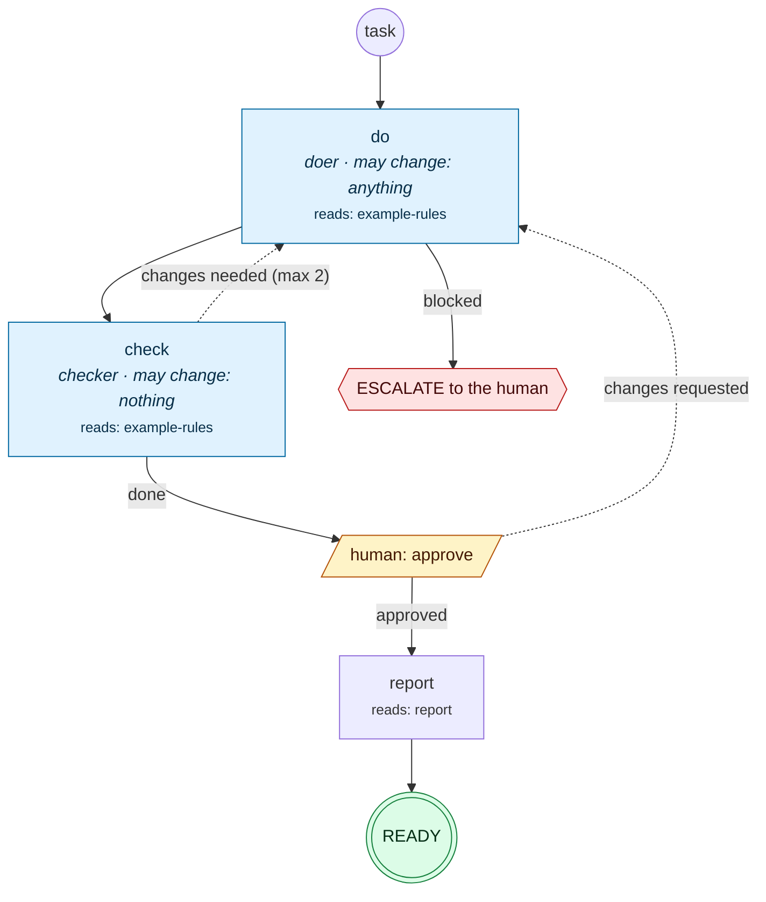

# psai

A tool-agnostic agent harness for Claude Code, opencode, pi and oh-my-pi (omp). It ships **vanilla**: a workflow engine, a guide that builds your own workflows with you, knowledge capture, and empty, documented folders. You fork it and build your own stack in the fork. Every skill is model-invoked, so agents run your workflows on their own.

## Use it
1. Fork this repo on GitHub, then clone **your fork** anywhere:
   ```sh
   git clone <your-fork-url> psai && cd psai
   ```
2. Install. It works from wherever the clone is; preview first:
   ```sh
   ./install.sh --dry-run
   ./install.sh
   ```
3. Ask any agent to set up your harness. The `customize-harness` skill interviews you one question at a time, then builds your first workflow with its steps, roles, guides and templates. Each piece is filed per [LAYOUT.md](LAYOUT.md), validated and staged; at the end of the task the `retro` skill turns it into one PR on your fork for you to merge.

From then on, give agents tasks as usual. `work` routes each task to one of your workflows and runs it, then runs a retro.

`install.sh` also links the `psai` command into `~/.local/bin`: `psai status`, `psai doctor`, `psai sync`, `psai retro`, `psai update`, `psai adopt <skill>`, `psai check`, `psai context`, `psai graph`, `psai simulate`, `psai resolve`, `psai install`.

## Get updates: the sync skill
```sh
git remote add upstream <psai-upstream-url>   # once, in your clone
```
Then either end your workflows with a `sync` node (`handover → retro → sync → ready`; customize-harness offers it) or ask any agent to sync. Sync checks first, deterministically and with a short-timeout fetch: new commits on your fork or upstream, an install that doesn't match HEAD, pending migrations, sessions or staged changes not yet in a PR, tool drift. Nothing out of sync: it stops at zero cost. Otherwise it fast-forwards your live clone (only fast-forwards, keeping your local inbox entries), re-installs, runs pending migrations, adopts drift worth keeping by staging it, and opens ONE PR for this machine (`psai/sync-<host>-<date>`) with everything staged or captured, plus a merge of new upstream commits. A conflict changes nothing and reports "psai update waiting: needs you".

**Trade-off:** psai has no background job, no cron and no startup check. It updates only when a workflow runs sync, or when you ask an agent to sync (`psai sync` runs the deterministic part by hand).

psai never ships files in the places you own (your workflows, steps, roles, guides, templates, knowledge, `my-skills/`, `skills.yaml` and `instructions/owner.md`). Upstream changes therefore merge without conflicts. `scripts/check.sh` tests exactly that.

## How it works
- **The nudge:** each tool gets a plugin that injects a short, live always-on text (about 170 words plus a line per workflow): the core rules, your `owner.md`, "run the request-router skill first", your workflows' names and `when`, "to add or change a skill, use customize-harness", when to run the retro outside a workflow, how many skills in your tool folders psai doesn't manage, and how many earlier sessions still wait for a retro (only when some do).
- **`request-router`:** decides each request. A matching workflow runs; a repeatable task with no workflow escalates and offers `customize-harness`; a one-off is handled normally.
- **`work`:** the engine, read once a workflow is chosen. It runs the workflow node by node:
  - a fresh agent per role;
  - each role's git diff checked against its `may_change`;
  - loop limits;
  - escalations in one fixed format;
  - a final report.

  `trace.sh` refuses any move that isn't an edge of the workflow.
- **`customize-harness`:** bootstraps your first workflow, and later adds or changes one piece. It offers proven design patterns as options, never as defaults.
- **`capture-knowledge`:** agents record facts, decisions and proposed rules in inboxes. Nothing goes to GitHub while a task runs.
- **`retro`:** at the end of a task (`work` always runs it after a workflow; outside workflows the agent runs it when it captured or staged something; a session that ended without one is flagged in the next session's nudge). It reads the run (trace, inbox entries, escalations, loops at their limit, rejected diffs, review findings, time and tokens), ranks findings, stages what's worth keeping and opens ONE PR on your fork with everything from the task, the report as its description. Nothing worth changing: no PR.
- **`sync`:** runs only where a workflow has a `sync` node, or when you ask. See "Get updates".
- **Session ledger:** each tool's plugin records every session locally in `.state/sessions/` (git-ignored): tool, project, start and end, workflows, escalations, retro done, captured counts, drift, psai version. Retro and sync read and mark it; `psai status` and `psai doctor` summarize it.
- **Migrations:** `migrations/NNNN-*.sh` run once per machine from install.sh (and so from sync and `psai update`).
- **Skills:** roles and steps name the skills they need (`skills: {required, optional}`); `work` lists them in each role agent's brief. Your own skills live in `my-skills/`, other people's are pinned in `skills.yaml`, and `harness.py skills` shows every skill your tools can see. Skills psai doesn't manage are reported, never blocked; `install.sh --adopt <name>` brings one in. See [my-skills/README.md](my-skills/README.md).

## Layers
| Layer | Answers | Written by | Loaded |
|---|---|---|---|
| skill | how the machinery runs | upstream | discovered by the tool |
| role | who I am and what I may touch | you | when the role starts |
| step | what happens at this point | you | when the step runs |
| guide | how this kind of work must be done | you | when a role or step attaches it (`read:`) |
| template | the exact output format, with an example | you | when a step attaches it |
| knowledge | what's true, and what was decided and why | agents, via the inbox | on demand, via `knowledge/INDEX.md` |

During a task, agents write only to knowledge inboxes and to the task's report. Everything else changes through `customize-harness`, which only stages it (in `.state/stage`, a separate worktree); the retro's (or sync's) one PR carries it, and you approve it. Precedence, most specific wins: `<repo>/.psai/` > the step or role and its `read:` files > `instructions/owner.md` > `instructions/global.md`.

## Structure
```
instructions/global.md   core rules in the injected nudge (≤120 words); your rules go in instructions/owner.md
plugins/                 one per tool (claude, pi, omp, opencode); each injects `scripts/harness.py context` live
skills/                  request-router, work (engine, escalation format, check-diff.sh, trace.sh), customize-harness (+ patterns/), capture-knowledge, retro, sync
workflows/ steps/ roles/ guides/ templates/ knowledge/ my-skills/   yours; empty in vanilla (README only)
skills.yaml              yours, not shipped: pinned skills from other people, and an ignore list
scripts/                 psai.py (the `psai` command), check.sh, simulate.py, graph.py, harness.py, skills.py, ledger.py, sync.py, retro.py, test-*.sh
migrations/              NNNN-<slug>.sh, run once per machine
schemas/                 stack.schema.json: the format of a stack's stack.yaml (ADR 0011)
VERSION                  the framework's version
.state/                  local, git-ignored: the session ledger, the stage worktree, retro reports, install and migration records
evals/                   run.sh, driver.py, fixtures/, scenarios/, graders/, results/
docs/decisions/          ADRs about psai itself
LAYOUT.md                where every kind of file goes, and who owns it
```

## Example workflow (test content)
Vanilla has no workflows. This is the tiny, neutral `example` workflow from `evals/fixtures/harness-content/`, which the tests use. Dotted edges are loops; each automatic loop shows its limit. Your own workflows' diagrams go in `workflows/GRAPHS.md`.

<!-- graph:evals/fixtures/harness-content/workflows/example.yaml:start -->

<!-- graph:evals/fixtures/harness-content/workflows/example.yaml:end -->

## Install details
It installs only for tools whose config folder exists (`~/.claude`, `~/.config/opencode`, `~/.pi/agent`, `~/.omp/agent`):
- links `~/.psai` to your clone (set `PSAI_HOME` to use another path; set it for your tools too, since the skills and plugins read it);
- links each skill into `~/.claude/skills` and `~/.agents/skills`, never replacing one that isn't its own, and removes its own stale links: psai's skills, your `my-skills/`, and each pinned `skills.yaml` entry (fetched into the git-ignored `.skills-cache/`; network only when the pin changes);
- drops a `README-psai.md` into both folders saying which skills are psai's and how to adopt the rest (`./install.sh --adopt <name>`);
- installs ONE plugin per tool, which injects the nudge read live from `~/.psai`:
  - **Claude Code:** adds this repo as a marketplace (`.claude-plugin/marketplace.json`) and installs `psai@psai` (a SessionStart hook);
  - **pi:** links the extension `~/.pi/agent/extensions/psai.ts`;
  - **omp:** links the extension `~/.omp/agent/extensions/psai.ts`;
  - **opencode:** writes a stub `~/.config/opencode/plugin/psai.js` that imports the live plugin;
- links the `psai` command, `~/.local/bin/psai` (`PSAI_BIN` changes the folder), runs pending migrations and records the installed commit in `.state/` (`PSAI_STATE` moves it);
- removes v1's import lines and marked blocks from `CLAUDE.md` and `AGENTS.md` files, keeping everything else.
- migration 0001 removes the legacy base link `~/.harness` (its name before the rename to `~/.psai`) if it is a link to a psai clone, after install relinks what went through it; anything else at that path is left alone.

It backs up `~/.claude/settings.json` before the plugin CLI first changes it. opencode reads both skill folders, so it loads each skill once and logs a `duplicate skill name` warning; `OPENCODE_DISABLE_CLAUDE_CODE_SKILLS=1` silences it. **Uninstall:** `./install.sh --uninstall` (backups are kept).

## Tests
```sh
scripts/check.sh              # L0 structure, L1 installer and fork updates, L2 simulator
scripts/check.sh --discover   # plus: opencode, pi and omp list the skills from a temp HOME
evals/run.sh                  # L3 + L4 AI evals, headless, on throwaway copies (costs money; keep it small)
```
- **L0:** LAYOUT placement, every README, frontmatter, every `step`/`read:`/`role` path, and the graph rules: reachable, ends at ready, escalate or a handoff, and every automatic loop has a limit. Also checks that diagrams are fresh, that `check-diff.sh` enforces `may_change`, and that `trace.sh` enforces the graph.
- **L1:** install, update, uninstall, dry-run, idempotency, no clobbering, stale-link and v1 cleanup for all four tools. `scripts/test-plugins.sh` proves, with no AI and no network, that each plugin's nudge reaches the session. Also checks that a fork with user content pulls an upstream change to every upstream-owned file without conflicts.
- **Skills (L0/L1):** the registry in a temp HOME with a skill in every location, `skills:` frontmatter, pinned `skills.yaml` entries fetched from a local git repo (no network), the ignore list, adopting your own skill and a pack's, and the checks (a required skill that resolves nowhere fails; duplicates and project-only required skills warn).
- **Sync, retro, ledger (L0/L1):** `scripts/test-sync.sh` in temp HOMEs against bare local git remotes, no network: the out-of-sync check against crafted states (behind, install drift, unsynced, staged, drift, upstream, nothing to do → a no-op), migrations running once, the ff-only update keeping inbox entries, conflicts and divergence changing nothing, the ledger written by each plugin's hooks, one PR branch per run, and retro handing its report to a following sync node. `test-plugins.sh` also checks that real pi, omp and opencode sessions write a ledger record.
- **L2:** `simulate.py` walks each workflow with scripted outcomes (`workflows/<name>.cases.yaml`).
- **L3/L4:** see [evals/README.md](evals/README.md).
