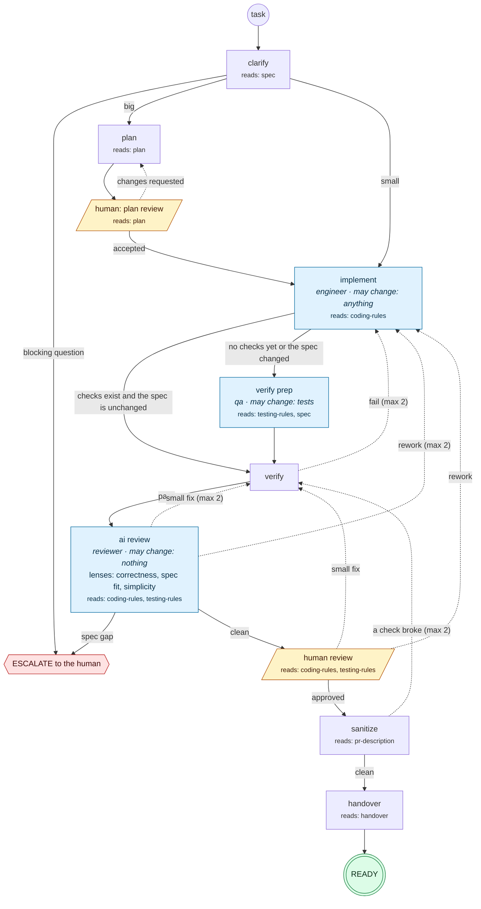

# psai

A tool-agnostic agent harness for Claude Code, opencode, pi and oh-my-pi (omp). It ships **vanilla**: a workflow engine, a guide that builds your own workflows with you, knowledge capture, and empty, documented folders. Inspired by [mattpocock/skills](https://github.com/mattpocock/skills), but every skill is model-invoked, and the work runs through workflows and roles you define.

## How it works
- **`work`:** for any task, the engine routes it through `workflows/ROUTING.yaml` and runs the chosen workflow node by node. It starts a fresh agent per role, checks each role's git diff, enforces loop limits, escalates in one fixed format, and finishes with a handover. With no workflows (vanilla), it escalates and offers `customize-harness`.
- **`customize-harness`:** interviews you one question at a time, then builds your first workflow, with its steps, roles, guides and templates. Each piece is filed per [LAYOUT.md](LAYOUT.md), validated, and committed on a branch. It offers proven design patterns as options; you choose. Later runs add or change one piece.
- **`capture-knowledge`:** agents record facts, decisions and proposed rules in inboxes. Promotion happens by PR, which you merge.

## Layers
| Layer | Answers | Written by | Loaded |
|---|---|---|---|
| skill | how the machinery runs | owner, rarely | discovered by the tool |
| role | who I am and what I may touch | owner | when the role starts |
| step | what happens at this point | owner | when the step runs |
| guide | how this kind of work must be done | owner | when a role or step attaches it (`read:`) |
| template | the exact output format, with an example | owner | when a step attaches it |
| knowledge | what's true, and what was decided and why | agents, via the inbox | on demand, via `knowledge/INDEX.md` |

During a task, agents write only to knowledge inboxes and to the task's PR description or handover. Everything else changes through `customize-harness`, as a PR you approve. Precedence, most specific wins: `<repo>/.harness/` > the step or role and its `read:` files > `instructions/global.md`.

## Structure
```
instructions/global.md   always loaded (≤250 words)
skills/                  work (engine, escalation format, check-diff.sh), customize-harness (+ patterns/), capture-knowledge
workflows/               ROUTING.yaml (+ cases); your <name>.yaml state machines (+ cases)
steps/ roles/ guides/ templates/   your pieces; empty in vanilla
knowledge/               INDEX.md, inbox.md, facts/, decisions/, roles/<role>/
scripts/                 check.sh, simulate.py, graph.py, harness.py
evals/                   run.sh, driver.py, fixtures/, scenarios/, graders/, results/
docs/decisions/          ADRs about psai itself
LAYOUT.md                where every kind of file goes
```
Every folder's README says what belongs there, its format, and points to an example.

## Example workflow (test fixture)
Vanilla has no workflows. This is the coding workflow from the test content in `evals/fixtures/harness-content/`, which is also what the L4 eval bootstraps from the owner's choices. Dotted edges are loops; each automatic loop shows its limit.

<!-- graph:evals/fixtures/harness-content/workflows/coding.yaml:start -->

<!-- graph:evals/fixtures/harness-content/workflows/coding.yaml:end -->

## Install
```sh
git clone https://github.com/noueii/psai ~/workspace/github.com/noueii/psai
~/workspace/github.com/noueii/psai/install.sh --dry-run   # see what it would change
~/workspace/github.com/noueii/psai/install.sh
```
It installs only for tools whose config folder exists (`~/.claude`, `~/.config/opencode`, `~/.pi/agent`, `~/.omp/agent`):
- links `~/.harness` to the clone;
- links each skill into `~/.claude/skills` and `~/.agents/skills`, never replacing one that isn't its own, and removes its own stale links (such as v1's `task-loop` and `sanitize-pr`);
- adds one line, `@~/.harness/instructions/global.md`, to `~/.claude/CLAUDE.md` and `~/.omp/agent/AGENTS.md`;
- inlines `global.md` between `<!-- harness:start -->` and `<!-- harness:end -->` in `~/.pi/agent/AGENTS.md` (or the `CLAUDE.md` pi already uses) and in `~/.config/opencode/AGENTS.md`.

Before its first edit of an existing file, it saves `<file>.harness-backup`. opencode reads both skill folders, so it loads each skill once and logs a `duplicate skill name` warning; `OPENCODE_DISABLE_CLAUDE_CODE_SKILLS=1` silences it.

**Update:** `git -C ~/.harness pull --autostash && ~/.harness/install.sh`. **Uninstall:** `~/.harness/install.sh --uninstall` (backups are kept).

## Tests
```sh
scripts/check.sh              # L0 structure/LAYOUT/graph, L1 installer in temp HOMEs, L2 simulator
scripts/check.sh --discover   # plus: opencode, pi and omp list the skills from a temp HOME
evals/run.sh                  # L3 + L4 AI evals, headless, on throwaway copies (costs money; keep it small)
```
- **L0:** LAYOUT placement, every README, frontmatter, every `step`/`read:`/`role` path, and the graph rules: reachable, ends at ready, escalate or a handoff, and every automatic loop has a limit. Also checks that README diagrams are fresh and that `check-diff.sh` enforces `may_change`.
- **L1:** install, update, uninstall, dry-run, idempotency, no clobbering, stale-link removal, for all four tools.
- **L2:** `simulate.py` walks each workflow with scripted outcomes (`workflows/<name>.cases.yaml`).
- **L3/L4:** see [evals/README.md](evals/README.md).
