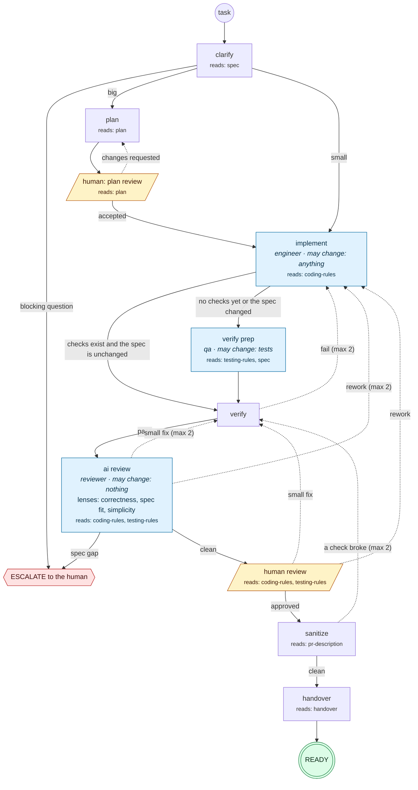

# evals/fixtures/harness-content/

TEST content for the harness: the owner's coding setup (workflow, routing, steps, roles, guides, templates, role knowledge, and a global.md with owner rules). It is never installed. Tests overlay it on a throwaway copy of the vanilla harness:
- `scripts/check.sh` and `scripts/simulate.py` validate it (L0, L2);
- the L3 eval scenarios run on it.

The tree mirrors the harness root, so every file follows `LAYOUT.md`.

## coding
<!-- graph:coding:start -->

<!-- graph:coding:end -->
